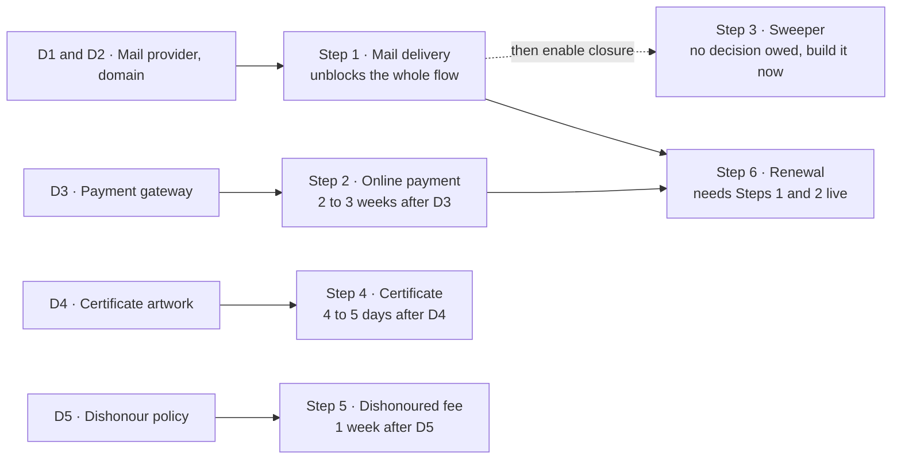

# LCCI Membership — Completion Plan & Development Hold

**Status: parked.** As of 2 November 2026 none of this is being built.
Live copy, for comments and edits: <https://claude.ai/artifact/MkejWofZ6DjWQyHB9UEHqf>

## Parked on 2 November 2026

**None of the six steps below is being built.** Later the same day this plan was
written, the Chamber decided the rebuilt site should be content only: joining,
member sign-in, fees and renewal all stay on the existing portal at
`membership.lcci.org.pk`, which is where lcci.com.pk sends people today.

Nothing was deleted. The registration, fee, approval and renewal code is finished,
tested and still in the tree behind one switch, `MEMBERSHIP_PORTAL_ENABLED` in
`src/membership/portal.ts`. The public buttons now point at the Chamber's portal,
the transactional routes redirect to it, and the admin's Applications, Fees and
Promises sections are hidden.

The five decisions in the register below are no longer owed, and the estimates
stand if the Chamber asks for this back. Read the rest as a costed plan on the
shelf, not as work in progress.

## Where registration stands today

A visitor can open an account and reach the application wizard, but cannot receive
the code that lets them in: no mail provider is configured, so the mailer falls back
to its console transport. The flow is complete in code and unusable in production
until Step 1 lands.

Self-registration shipped on 2 November 2026. `/membership/register` opens an
account, verifies the address with a six-digit code, creates the session and starts
a DRAFT application; all five public Join LCCI and Apply entry points resolve to it.
Everything the Secretariat needs on the far side was already built: verification
checklist, deficiency notices, fee receipting, approval with a locked
membership-number allocation, the applicant tracker, the admin queues and the SLA
report.

| Stage of the journey | Status | What is missing |
| --- | --- | --- |
| Open an account | Works | Nothing |
| Receive the verification code | Not built | No mail provider; nothing is delivered |
| Fill in and submit the form | Works | Nothing |
| Staff verification and deficiencies | Works | Nothing |
| Pay the membership fee | Partly | Pay order or cheque only, receipted by hand |
| Approval and membership number | Works | Nothing |
| Proof of membership | Not built | No certificate is issued |
| Abandoned or unanswered applications | Not built | Transitions defined, nothing fires them |
| Renew the following year | Not built | No renewal application exists |

The three stages that do not work are the first thing a real applicant meets, the
one thing they must do with money, and the only thing they get to keep. None of the
three is held up by code we cannot write.

## Decision register — what is holding development

Five decisions are owed before the blocked steps can start. Development is held on
all of them: each one determines what gets written, not merely when, so guessing an
answer means writing code twice.

| # | Decision owed | Who decides | Holds | Status |
| --- | --- | --- | --- | --- |
| D1 | Which mail provider, and fund the account | LCCI | Step 1, and therefore the whole flow | Open |
| D2 | Which domain sign-in mail is sent from | LCCI + IT | Step 1 | Open |
| D3 | Which payment gateway, and who holds the merchant account | LCCI Finance | Steps 2 and 6 | Open |
| D4 | Certificate wording, seal and who signs it | LCCI Secretariat | Step 4 | Open |
| D5 | What happens when a pay order is dishonoured | LCCI Finance | Step 5 | Open |

**D2 is the one that is easy to get wrong.** Staff use `@lcci.org.pk` while the
public site is `lcci.com.pk`. A sign-in code must come from the domain the member
sees in the address bar; sending it from a different one teaches members that LCCI
login mail arrives from assorted domains, which is the precondition phishing needs.
The mailer's own notes already record this as blocking the login flow rather than
the launch.

D1 also carries a cost the Chamber has to approve, and D3 carries a merchant
agreement and a per-transaction fee. Neither is a technical choice.

## Step 1 — Mail delivery · BLOCKED on D1, D2

Almost no code is owed here, which is why it is first: the application sends mail
correctly already and the delivery path is finished. What is missing is an account,
a sending domain and four DNS records.

`getMailer()` looks for `POSTMARK_TOKEN` and `MAIL_FROM`. Both are empty, so it
returns the console transport. In production it logs the absence loudly —
deliberately, because silently not sending mail is the failure that takes longest to
notice, since every flow still appears to succeed. The outbox, its retry backoff,
the `email-outbox` job on a five-minute tick and the 30-day payload prune are all
built and tested.

**Work owed**

- [ ] Open and fund the provider account (D1)
- [ ] Settle the sending domain (D2) and create the mailbox or sender signature
- [ ] Publish SPF for the sending domain, minding the ten-lookup limit
- [ ] Publish DKIM on a provider selector, alongside cPanel's own DKIM for mail that genuinely originates there
- [ ] Publish DMARC at `p=none` with an aggregate report address
- [ ] Set `POSTMARK_TOKEN`, `MAIL_FROM` and the two stream names in the server environment
- [ ] Read DMARC aggregate reports for two to four weeks, then move to `p=quarantine`, then `p=reject`

Going straight to `p=reject` on a domain whose existing mail flows nobody has fully
inventoried will silently break something, so the last item is a month of watching,
not a deployment step.

**Done when** a registration code sent to an external address lands in the inbox,
not the spam folder, from the same domain as the site; the `email_outbox` row
reaches `sent` with a provider id; and a deliberately failed send retries on
schedule rather than disappearing.

**Estimate** half a day of configuration once D1 and D2 are answered, then a month
of DMARC observation that blocks nothing else.

## Step 2 — Online fee payment · BLOCKED on D3

A new member today pays at a bank counter and waits for a human to receipt it.
`payments.ts` refuses anything else in as many words: only a pay order or a cheque
can be receipted, neither cash nor an online payment. The `online` value already
exists in the method enum, so the shape was anticipated — nothing stands behind it.

This is the largest of the six steps and the one most sensitive to D3, because the
gateway decides the integration: 1LINK, Easypaisa, JazzCash and a bank's own hosted
checkout differ in their callback model, their settlement file and whether they can
be reconciled at all without a daily download.

**Work owed, once a gateway is chosen**

1. A payment intent record, created when the applicant starts a payment, carrying
   the fee snapshot so a tariff change mid-payment cannot alter what was charged.
2. Redirect or hosted-checkout handoff, with the return URL and the applicant's
   session re-established on the way back.
3. A webhook or callback endpoint, treated as hostile input: signature verified,
   amount and currency checked against the intent, idempotent on the gateway's own
   reference so a retried callback cannot receipt twice.
4. Receipting on confirmed settlement, not on the redirect — the redirect means the
   applicant's browser came back, which is not the same as money arriving.
5. Reconciliation against the gateway's settlement file, next to the existing
   `bank-match.ts` so Finance has one place to work.
6. Lift the refusal in `payments.ts` for `online` only, leaving cash refused.
7. A failed, abandoned and double-payment path, each visible to Finance in the admin.

Steps 3 and 4 are where this goes wrong if hurried. Receipting on the redirect is
the classic defect, and it hands out membership numbers for payments that never
settled.

**Done when** an applicant can pay the fee online, the application reaches the same
receipted state a pay order produces, a replayed callback changes nothing, and the
day's payments reconcile against the gateway's own file without hand-matching.

**Estimate** two to three weeks, including a sandbox cycle with the provider. Not
startable before D3.

## Step 3 — Expiry and no-response sweeper · READY TO BUILD

This is the only step with no external dependency, and the one quietly accruing bad
data while the others wait. Build it next.

Both transitions are already defined, guarded and covered by the workflow tests.
Nothing fires either one. `JOB_SCHEDULE` has seven jobs and no sweeper among them, so:

- `expire_draft` (`DRAFT` → `DRAFT_EXPIRED`, ninety days untouched) never runs, so
  abandoned drafts accumulate for ever — and with them their uploaded documents. The
  transition's own note calls that deletion the single most valuable one in the
  system for PII minimisation, and it is not happening.
- `close_no_response` (`AWAITING_APPLICANT` → `CLOSED_NO_RESPONSE`) never runs, so an
  applicant who abandons a deficiency sits in `AWAITING_APPLICANT` indefinitely,
  counting against the SLA report for ever.

The columns the sweeper needs are in place: `applications.expires_at`, and
`respond_by` with `reminder_count` on the deficiency row, which exists precisely
because the transition is specified to fire only after a reminder sequence.

**Work owed**

1. A `membership-sweep` entry in `JOB_SCHEDULE` and its handler in `registry.ts` —
   the two are bound by `satisfies`, so a schedule without a handler is a type error
   rather than a job that never runs.
2. Draft expiry: select drafts past `expires_at`, take the transition, delete the
   draft's documents through the existing document store, write the audit entries.
3. The reminder sequence: a reminder at a fixed interval before `respond_by`,
   incrementing `reminder_count`, with a new mail template.
4. No-response closure once the sequence is exhausted, setting the refund disposition
   flag the transition's note calls for — a fee may have been receipted before the
   deficiency was raised.
5. Batch and budget it like its neighbours: a 45-second wall-clock budget,
   `more: true` when work remains, so a backlog drains over several ticks instead of
   being killed mid-run.
6. Integration tests at the boundaries: one day short of expiry, one day past, a
   draft already withdrawn, a deficiency answered on the final day.

**One ordering constraint, and it matters.** The code can be written and tested now,
but **the no-response closure must not be switched on in production before Step 1
delivers mail.** Reminders queue into the outbox happily with no provider configured
and are never delivered — so enabling closure first would close applications for not
answering a letter that was never sent. Ship draft expiry on its own if Step 1 is
still outstanding; it depends on no notification.

**Done when** a draft past ninety days is expired with its documents deleted and an
audit entry written, a stale deficiency is reminded then closed with the refund flag
set, both appear in the existing admin queue views that already list these states,
and the SLA report stops counting closed applications.

**Estimate** three to four days including tests. Startable today.

## Step 4 — Membership certificate · BLOCKED on D4

An approved member currently receives a membership number and a tracker page, and
nothing they can print, file or show a bank. Every mention of a certificate in the
codebase is a comment anticipating one: `approval.ts` says the number "will be
printed on a certificate", and `numbering.ts` justifies its format on the same
grounds.

The plumbing is unusually ready. `server/documents/` already holds the store, the
cipher, the filename builder, the PDF guard and an authenticated serve path, all
built for applicant uploads and all reusable in the other direction.

What is blocked is not the generator but the artefact: exact wording, the crest and
seal at print resolution, which office bearer signs it, whether the signature is an
image or a space for ink, and whether it carries a validity year or a grant date.
Guessing any of these produces a document the Chamber will not issue.

**Work owed, once D4 is answered**

1. The certificate template, with the membership number, firm name, category and the
   date `approval.ts` already fixes.
2. Generation on approval, stored through the existing document store rather than
   rendered on each request, so the issued artefact is immutable and auditable.
3. A download in the member portal, and a reissue in the admin for a lost copy, both
   audited.
4. A verification route, if the Chamber wants one — a public page that confirms a
   number and firm name without exposing anything else. Worth asking for: it is what
   a bank or a foreign buyer actually does with a certificate.

**Done when** approval produces a certificate the Secretariat accepts as its own,
the member can download it from the portal, a reissue is recorded, and the stored
file is byte-identical on every download.

**Estimate** four to five days once the artwork and wording exist.

## Step 5 — Dishonoured fee path · BLOCKED on D5

A receipted pay order that the bank later dishonours has no path back. The fee reads
as paid, the application proceeds on that basis, and there is no transition to undo
it — a known dead end, recorded as such before this plan.

The gap is a policy question before it is a code one, which is why it is D5 rather
than a ticket. The answers needed: does the application revert to awaiting payment
or close; is there a grace period for the applicant to replace the instrument; is a
charge levied; and if the member was already approved and numbered, is the number
withdrawn or suspended. The last is the hard one — `numbering.ts` allocates under a
lock precisely because a number must never be reused, so withdrawal cannot mean
handing it back to the pool.

**Work owed, once D5 is answered**

1. A dishonour action in the admin, against the receipted payment rather than the
   application, with a reason and the bank's advice attached.
2. The transition the policy implies, added to `workflow.ts` with its guards and
   note, like every other transition.
3. A replacement-instrument path so the applicant can present another pay order
   without starting again.
4. Notification to the applicant, and the Finance view that shows what is outstanding.

**Done when** Finance can record a dishonour, the application lands in the state
policy dictates, the applicant is told and can replace the instrument, and the audit
trail shows the whole sequence.

**Estimate** a week, mostly in the approved-and-numbered case.

## Step 6 — Renewal · BLOCKED, downstream of Steps 1 and 2

`/membership/renew` has a public page and nothing behind it. There is no renewal
application, no dues cycle and no reminder — only `year.ts` anticipating one, where
the grant date is noted as "1 April for a renewal year", and `tracker.ts` observing
that a renewal adds a year row.

This is last on purpose. Renewal is the registration flow run annually against an
existing member, so it inherits everything the earlier steps settle: it needs mail
for the reminder, online payment to be worth having at all (twenty thousand members
renewing by pay order is the current year's workload unchanged), and the certificate
if renewal reissues one. Building it before those is building it twice.

**Work owed**

1. A renewal application type reusing the existing wizard, prefilled from the
   member's last approved snapshot, asking only what changes.
2. The dues cycle against `year.ts`, with the 1 April convention made explicit rather
   than inferred.
3. A reminder sequence before the due date, and a lapsed state with whatever grace
   period policy allows.
4. What lapsing costs: directory listing, certificate validity, access to services.
   This needs the Chamber's answer too, and is worth asking alongside D4.
5. The renewal receipt and, if applicable, the reissued certificate.

**Done when** a member is reminded, renews, pays, and their year row is added with
the directory and certificate reflecting it — without the Secretariat touching
anything.

**Estimate** three to four weeks. Do not start before Steps 1 and 2 are live.

## Sequencing and the critical path

Mail is the critical path; only the sweeper can start without a decision. Arrows run
from what is owed to what it holds up.

Step 3 is the only box with nothing to its left, which is the whole argument for
building it next. Step 1 is the critical path, and it is also the cheapest of the six
in code: until it lands, no applicant can finish registering.

**Order of play**

1. Put D1 and D2 to LCCI this week. They gate the step that gates everything, and
   neither needs a developer to answer.
2. Build Step 3 meanwhile. Ship draft expiry first and leave no-response closure
   switched off until mail is live.
3. Raise D3 in the same conversation as D1, because the merchant account will take
   longest to arrange.
4. Step 1 as soon as the provider account exists; Step 2 once the gateway is settled.
5. Steps 4 and 5 in whichever order their decisions arrive. Neither blocks anything
   else.
6. Step 6 last, and not before Steps 1 and 2 are live.

If only one thing happens this week, make it D1 and D2.

## Not in this plan

These are real but belong to another lane or another plan.

- **The public membership section** — `/membership` and its pages (why join,
  categories, renew, directory, FAQs) are being built in the parallel CMS and
  frontend session, and several already exist. Treated here as a dependency, not a
  task.
- **The member directory** — twenty thousand legacy members, searchable. A migration
  problem of its own, with its own plan.
- **The legacy member import** — the reason portal accounts are OTP-only with no
  password: twenty thousand imported members cannot be given passwords they never
  chose. Already decided, not revisited here.
- **Staff-side features** beyond what the six steps touch: committees, certificates
  of origin, attestation, visa recommendation.
- **One known defect, carried deliberately.** `sign-in-form.tsx` still has the resend
  bug that was fixed in `register-form.tsx`: a resend refused for spacing collapses
  the form back to the first stage and takes away the code box from someone holding a
  valid code. It is a ten-line fix — the same `codeSent` latch — and it was left alone
  only because it was outside the registration change. Worth doing in the same sitting
  as Step 3, as it needs no decision from anyone.
